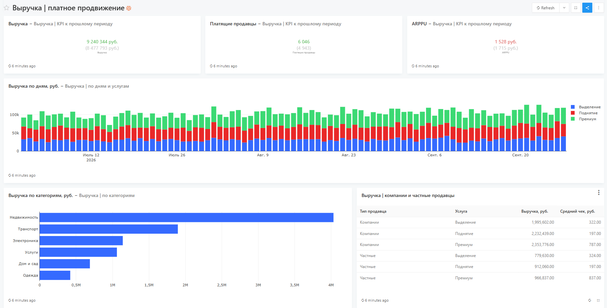
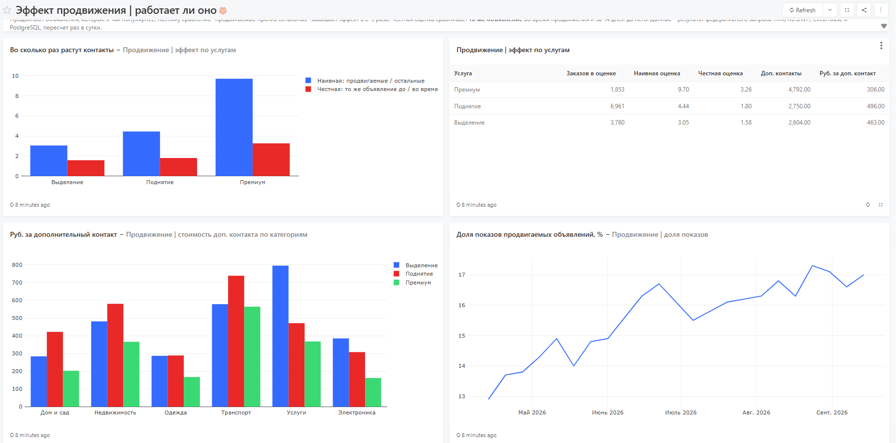
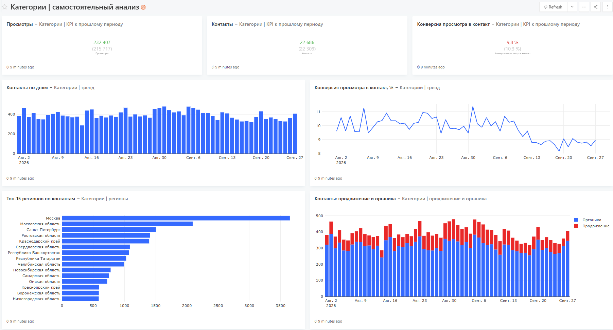
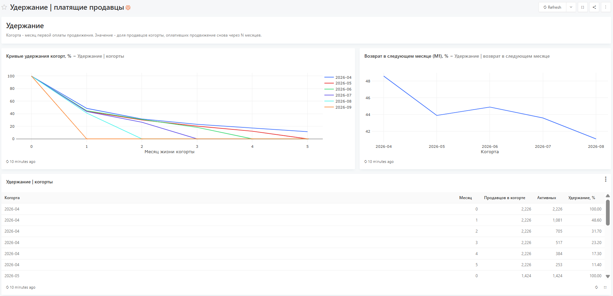
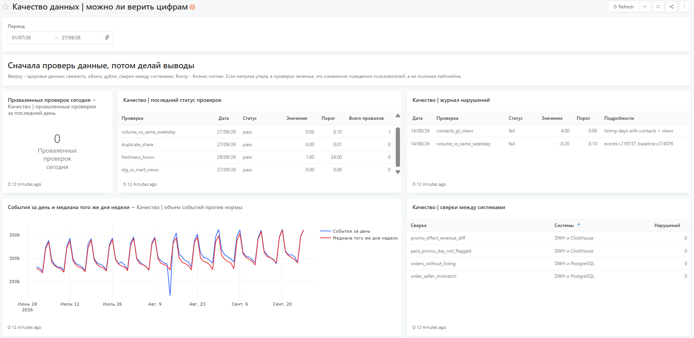
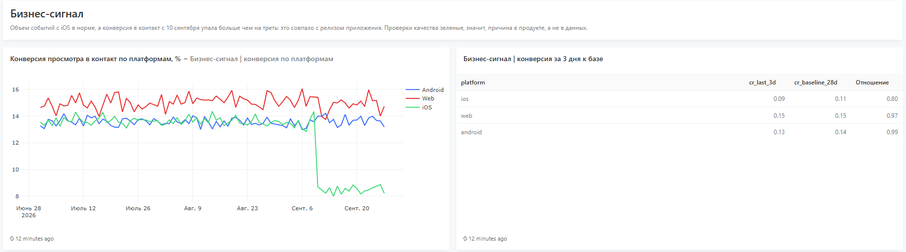
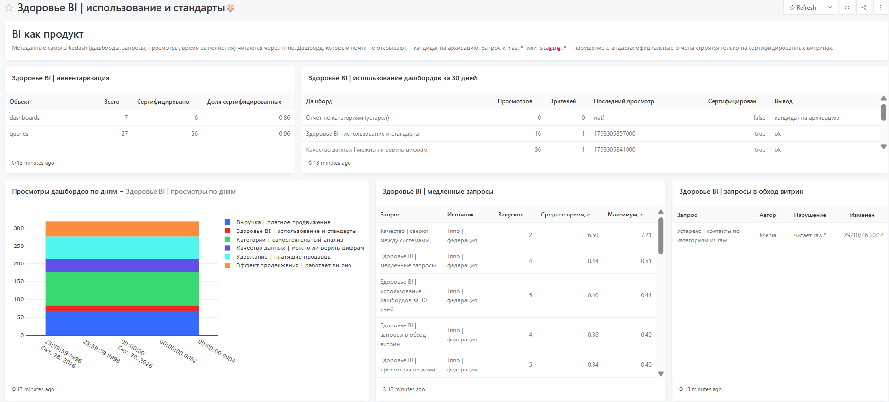

# Дашборды и принципы визуализации

Все дашборды описаны кодом в `redash/dashboards/*.json`, SQL лежит в `redash/queries/`.
Разворачиваются в Redash командой `make redash`, скриншоты ниже сняты с работающего стенда.

## Принципы

1. **Каждый дашборд отвечает на 1-2 вопроса конкретного пользователя.** Вопросы записаны
   в спецификации (`questions`) и в `requirements.md`.
2. **Иерархия: KPI | тренд | детализация.** Сверху 2-3 числа с изменением к прошлому периоду,
   ниже динамика, еще ниже разрезы. Взгляд идет сверху вниз так же, как вопросы.
3. **Число без базы ничего не говорит.** Каждый KPI показан рядом с предыдущим периодом
   такой же длины (счетчики Redash с target-значением).
4. **Тип графика выбирается по задаче данных.** Динамика - линия или столбцы по дням.
   Сравнение категорий и регионов - горизонтальные столбцы, отсортированные по значению,
   чтобы длинные названия читались без поворота. Состав - столбцы с накоплением, а не
   круговая диаграмма. Удержание - кривые по когортам.
5. **Одна ось Y.** Контакты и конверсия - два графика рядом, а не две шкалы на одном:
   двойная ось позволяет "нарисовать" любую корреляцию.
6. **Доли показываются в процентах.** Конверсии и доли пересчитываются в проценты в SQL,
   поэтому на счетчиках и осях сразу видно 9,8 %, а не 0,098.
7. **Все подписи на русском.** Названия дашбордов и графиков, легенды, заголовки таблиц,
   значения разрезов (услуги, типы продавцов, платформы).
8. **Подписи-выводы и контекст.** Текстовый блок над дашбордом объясняет, откуда данные
   и как читать.
9. **Скорость.** Дашборды читают из витрин и материализованных результатов, а не из сырых
   событий и не из федеративных запросов (цифры в `performance.md`).
10. **Self-service вместо очереди запросов.** Дашборд по категориям отдает менеджеру фильтры
    категории, платформы и периода. Новые разрезы добавляются в витрину, а не новым дашбордом.

## Выручка | платное продвижение

**Для кого:** финансовый аналитик, руководитель направления продвижения.
**Вопросы:** сколько приносит продвижение и как это меняется; за счет каких категорий и услуг.
**Источник:** финансовое DWH (`finance.promo_orders`, `finance.fct_promo_revenue_daily`).
Обновление раз в сутки.

## Эффект продвижения | работает ли оно

**Для кого:** руководитель направления продвижения, продакт.
**Вопросы:** во сколько раз продвижение реально увеличивает контакты; сколько стоит продавцу
дополнительный контакт.
**Источник:** `marts.promo_order_effect` - результат федеративного запроса Trino по DWH,
ClickHouse и PostgreSQL, пересчитывается раз в сутки.

Главный график - наивная и честная оценки рядом. Это ответ на исходный запрос
"покажите, насколько больше контактов у продвигаемых объявлений": так считать нельзя,
и дашборд показывает почему.

## Категории | самостоятельный анализ

**Для кого:** менеджер категории, без помощи аналитика.
**Вопросы:** как идут дела в моей категории; где проседает конверсия; сколько дает продвижение.
**Источник:** `marts.fct_category_daily`. Фильтры: категория (выпадающий список из запроса),
платформа, период. Обновление раз в час.

## Удержание | платящие продавцы

**Для кого:** руководитель направления, CRM.
**Вопрос:** возвращаются ли продавцы за продвижением.
**Источник:** финансовое DWH (`finance.fct_seller_retention`).

## Качество данных | можно ли верить цифрам

**Для кого:** BI-команда, дежурный по данным, все потребители.
**Вопросы:** можно ли верить цифрам; это поломка данных или изменение поведения.
**Источник:** `dq.*`, `marts.fct_platform_daily`, сверки Trino. Алерты: проваленные проверки
и падение конверсии платформы больше чем на 15%.

Верхняя часть - здоровье данных: 14 августа проверка объема поймала потерю батча событий.

Нижняя часть - бизнес-сигнал: с 10 сентября конверсия на iOS упала больше чем на треть,
а проверки качества зеленые. Значит, причина в продукте, а не в данных.

## Здоровье BI | использование и стандарты

**Для кого:** BI-команда. Подробно в `governance.md`.
**Вопросы:** какими дашбордами пользуются; что архивировать, что ускорить, где нарушены стандарты.
**Источник:** метаданные самого Redash через Trino-каталог `redash`.

Устаревший отчет по категориям никто не открывает, и он читает сырые события в обход витрин:
дашборд находит его сразу по двум признакам.

